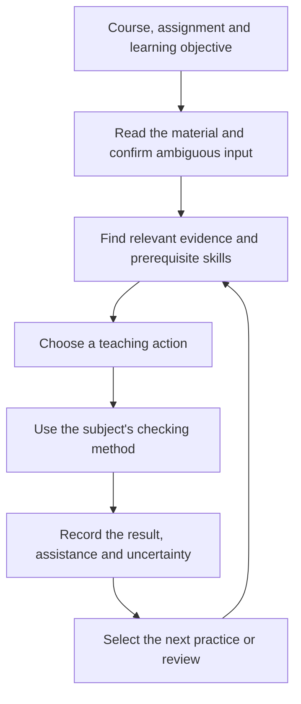

# Diana: shared learning engine from grade six through college

Status: implementation in progress, September 25 local / September 26 UTC, 2026. Shared course practice, owned-material practice, original-course publication controls and response rubrics are connected locally. The stage gates below remain separate from those engineering deliveries. This extends the existing application and preserves its Classes, Materials, Work, Calendar and tutoring workflows. The current execution ledger is `docs/engineering/roadmap-execution.md`.

## Direct assessment

The current work contains custom Diana engineering: versioned source retrieval, a curriculum graph, bounded exact checkers, confirmed problem state, recorded assistance, protected learning evidence and evaluation/training tools. It is not a complete sixth-grade-through-college learning system. A demonstrably durable competitive advantage also requires useful coverage, reviewed content and measured performance with learners.

RAG is implemented and connected for owned assignment sources and the approved reference textbook. Public reference retrieval uses lexical passage ranking with bounded skill/prerequisite reranking; citations retain source versions and page anchors. Assignment retrieval can use optional semantic indexing. These capabilities do not establish reliable understanding of arbitrary textbooks, scans, figures or every discipline.

The original 34-skill catalog and nine-chapter practice remain available. The shared framework now contains 47 competencies and 25 small practice collections with 39 authored activities. The three new scatter-graph tasks preserve all 36 preceding activity hashes. These are named task coverage, not complete curricula. Having every PDF page indexed does not mean every exercise, topic or grade is supported. The existing general chat and subject/grade model routing are broader than the checked learning activities.

## Current boundaries and remaining work

| Area | Current boundary | Work required |
| --- | --- | --- |
| Subject model | V2 domain/course/competency contracts and document subjects share the domain registry; source-bound lexical suggestions are proposed only | Reviewed automatic course/skill mapping for arbitrary sources |
| Curriculum | Versioned original-course publication, independent reviewer roles, exact payload binding, suspension and withdrawal are implemented | Real educator approvals, reviewed framework/institution mappings and useful breadth within each course |
| Assessment | Source checks, collapsed versioned rubrics and an offline human-assessment/adjudication tool are implemented; an adult-owner response-review API is coded but disabled pending migration, secrets and human operations | Actual educator agreement and safe live delivery; held-out passages and reviewed rubrics |
| Science | Requested units/precision, compound dimensions, explicit-species conservation, experimental-design cases, a trial-mean comparison and three scatter-graph checks run in saved practice | Educator-reviewed reasoning, richer graphs/diagrams and broader science topics |
| Adaptation | Fixed help rules remain active; private learned-policy loading rechecks receipts and supports rollback | Real reviewed trajectories, calibrated evaluation, production bundle storage and authorized activation |
| Multimodal | Real pinned local Whisper and TrOCR inference completed on three synthetic recordings and one synthetic line; Course Practice draft/confirmation integration remains inactive | Permissioned human samples, independent labels, device/memory qualification and controlled production enablement |
| Ingestion | Resumable PDF/text, progress/retry UI, extraction-quality signals and a bounded owner-scoped worker plus session-reloading supervisor are implemented | Supported scheduler, renewable delegated sessions, real long-document/background acceptance and extraction QA |
| Release | Latest frontend work verified locally; additive database work applied | Current production integration check, authenticated workflow acceptance, controlled rollout and production monitoring |

References in the checkout: `lib/learning-engine/contracts.ts`, `curriculum-graph.ts`, `problem-specification.ts`, `local-tutor.ts`, `learner.ts`, `learned-policy.ts`, and `lib/assignment-help/deterministic-verifiers.ts`. The delivery ledger and research protocol contain the executed evidence and existing external gates.

## Connected continuation

The local student path is **Classes > Materials > Guided practice**. It uses the class ownership and current tutoring policy, loads activity specifications from the server, saves immutable revisions, and reopens each question's last compatible draft. Selecting a different question saves changed work before opening it. Retry identities are retained after a save error. Old content versions are retained without silently attaching their work to an updated question.

| Subject | Grades 6–8 | Grades 9–12 | Introductory college | Feedback basis |
| --- | --- | --- | --- | --- |
| Reading / English | Compare two passages; revise a claim | Compare two passages; revise an evidence-based report | Compare a survey abstract and commentary; revise an academic claim | Exact source quotations plus revision criteria; interpretation and writing quality remain ungraded |
| Science | Measurements, speed and explanation practice | Measurements, density, atom/charge conservation and explanations | Measurements, force, atom/charge conservation and explanations | Requested units, significant figures, bounded dimensions and explicit species; interpretation remains ungraded |
| Math | Fractions, arithmetic mean and elementary geometry | Function value; quadratic solutions | College algebra foundation tasks | Existing bounded exact checkers, with all original reference chapter practice preserved |
| History | Compare authored source accounts | Evaluate a historical causal claim | Source context and corroboration | Exact quotations and review criteria; the example sources are clearly fictional, not licensed historical documents |

The September 26 expansion adds selected advanced-college work and separate Reading collections. Current coverage is 87 activities across 45 active collections and 67 competencies, spanning five subjects and four course levels. The preceding table records the earlier collection, not the complete current inventory. `course-coverage.ts` emits the current matrix and limitations; every cell remains partial authored coverage. Levels are course context, not inferred ability. All activities are original Diana engineering content with educator review pending; none can establish independent mastery or enter training automatically. Their checking, hints and examples use no language-model provider. Saving and resuming still use the authenticated server and database, so this is not a claim of a fully disconnected application. See `docs/engineering/curriculum-recognition-release-2026-09-26.md` for browser recognition, executed LoRA research and deployment status.

The implemented modules are `course-framework.ts`, `course-activities.ts`, `course-catalog.ts`, `course-tutor.ts`, `course-session.ts`, the course-practice API, and the guided-practice component. The original retrieval path now traverses the shared competency adapter with regression checks for every legacy skill.

### Practice from owned material

**Classes > Materials > a prepared source > Practice with passages** connects uploaded text/PDF passages to the same versioned activity, feedback and notebook contracts. Students choose up to three eligible passages and one task: reading evidence, argument revision or scientific explanation. They can browse pages or search the pinned source version with hosted embedding fallback explicitly disabled. The task uses the student's selected course level; this does not certify the source's grade alignment or adapt its reading difficulty.

The server reloads source text using owned version/block identifiers. It verifies assignment/class scope, exact page spans, source content hash and confirmation before creating an activity. Source text never supplies executable instructions, answer keys or approval flags. Quotes carry exact locations in the original source version; citation links can retrieve older versions outside the recent-material list. Tasks and source choices are pinned in the immutable notebook. Reopening verifies the binding again; saved drafts and transcription origins survive reload.

The bridge uses task templates and selected passages, not automatic subject understanding. It does not generate textbook answers or infer a numerical/scientific answer key from arbitrary prose. Interpretation, writing quality and scientific reasoning remain ungraded. Tables, diagrams, headings and unconfirmed text are excluded from this path. Page browsing returns at most 50 blocks and search returns bounded top matches, with coverage disclosed. All selected material stays excluded from training through this workflow.

Supporting modules are `material-activity.ts`, `activity-session.ts`, `material-practice-store.ts`, `/api/learning/material-practice` and `components/learning/material-practice.tsx`. Dynamic passage sessions are not counted as reviewed curriculum items. Source suggestions retain exact anchors and require review. Approved automatic V2 mapping for arbitrary textbooks remains open; original-course publication controls now exist but have no real educator approvals.

## The shared teaching loop

The same loop applies to algebra, literature, biology or college statistics. Its subject modules determine what constitutes evidence and what can actually be checked.

### Six shared components

1. **Course and competency map.** Every objective has an immutable ID, prerequisites, course membership, framework/institution alignment, intended level and review status. A textbook section is a source for an objective, not the objective's identity. Different books and courses can map to it without silently asserting equivalence.
2. **Problem and response record.** Preserve original sources, typed work, tables, mathematical expressions, diagrams and transcriptions with explicit provenance. Interpretations remain distinct from student confirmations and educator approvals.
3. **Evidence retrieval.** Search authorized course materials first, preserve editions and exact anchors, surface conflicting or insufficient evidence, and retrieve prerequisite explanations where useful. Public references stay separately attributed. Retrieval quality must be tested on held-out questions and sources for each supported domain.
4. **Teaching controller.** Choose clarification, an orienting question, a hint, a different example, practice or review. Use the student's confirmed attempt and history; do not infer a misconception from an unrelated attempt. Prefer local operations when adequate and use the existing authorized model route for flexible dialogue.
5. **Assessment method registry.** A capability declares subject, task family, valid input, exact limits, source requirements, review status and supported checks. A missing method falls back to clearly qualified guidance. Adding a subject name must not automatically authorize grading.
6. **Learning evidence and review scheduler.** Record assistance, independent attempts, uncertainty, retention and fresh-task transfer separately. Adjust support by demonstrated skills and accessibility preferences. Grade/course level provides context; it is not a single ability score. Evidence in one subject does not automatically establish competence in another.

## Subject modules

| Module | Shared tools reused | Distinct content and checks needed |
| --- | --- | --- |
| Reading and English | Source retrieval, quotations, reasoning steps, versioned rubrics, feedback history | Central idea, inference, vocabulary, literature, comparison, argument, grammar, revision, composition and research writing; interpretation and quality need rubric evidence, not only quote matches |
| Math | Expression/quantity representations, prerequisite map, practice, exact checking | Sixth-grade foundations through selected college courses; separate support for fractions/ratios, geometry, algebra, statistics, calculus and proof rather than labeling all as supported math |
| Science | Reading evidence, calculations, tables, graphs and explanation rubrics | Units, dimensional relationships, significant figures, chemical conservation, variables, models, experimental design and claim/evidence/reasoning, with explicit physics/chemistry/biology/earth-science content |
| History and social sciences | Reading/writing tools, source attribution, argument rubrics | Chronology, source perspective, corroboration, cause/effect and discipline-specific methods |
| Further college disciplines | Same course/evidence/controller infrastructure | Instructor-defined outcomes, advanced prerequisites, specialist methods and separately evaluated course modules |

Example: a density problem can reuse reading to identify givens, math to rearrange the expression, a science checker for compatible units, and a rubric for the explanation. A successful calculation alone cannot certify the scientific explanation or understanding of density.

## Assessment claims remain separate

- **Exact check:** a declared numeric, symbolic, unit or conservation check passed within its bounds.
- **Source check:** quoted or cited content occurs in an authorized source; interpretation is a separate question.
- **Rubric feedback:** reasoning or writing has been evaluated against stated criteria, with the reviewer/model and uncertainty disclosed.
- **Human approval:** a qualified reviewer approved the specific content or judgment.
- **Learning evidence:** independent and delayed performances support a limited skill estimate.

These are separate dimensions. A citation, model confidence or successful hint must never be upgraded automatically into human approval, correctness or mastery.

## Frameworks and grade progression

Use a common competency representation that can import framework identifiers and relationships. 1EdTech CASE supports competency/standards exchange, relationships and rubrics for K–12 and higher education. Adopting compatible identifiers does not itself establish certification, alignment accuracy or permission to reproduce content. [1EdTech CASE](https://www.1edtech.org/standards/case/about)

For English, use applicable state or school standards and course rubrics. Common Core's literacy structure explicitly connects reading, writing, speaking and listening with science and history from grade six. Its K–12 standards are not a complete college curriculum. [ELA/Literacy standards](https://www.thecorestandards.org/ELA-Literacy/)

For science, represent subject ideas, scientific practices and concepts that span disciplines. This follows the three dimensions described by NGSS; a school or jurisdiction's adopted curriculum remains the authority. [NGSS three-dimensional learning](https://www.nextgenscience.org/three-dimensional-learning)

Suggested release bands are grades 6–8, grades 9–12, introductory college and advanced course modules. Each band uses the same architecture. Actual courses, prerequisites, language complexity and instructor expectations determine behavior. Advanced college coverage must be named by supported course and task family.

## Execution order and completion gates

| Stage | Deliverable | Completion gate |
| --- | --- | --- |
| 1. Generalize the core | Subject registry, course/competency map, task contracts, capability routing and legacy adapters | Existing math/reading workflows and saved histories still work; an unknown subject/task cannot be silently graded; incompatible content invalidates approval |
| 2. Reading and English | Reviewed task sets, source-grounded reading, writing/revision rubrics and student-owned drafts across the release bands | Held-out passages and prompts, blinded educator agreement, multiple valid interpretations, source/claim distinctions and disclosure checks |
| 3. Science | Connected unit/chemistry checks plus reviewed data/graph and reasoning tasks | Valid/invalid units, conservation, uncertainty, source contradictions and unsupported diagrams tested; explanations assessed separately from calculations |
| 4. Broaden courses and modalities | Math foundations/selected college courses, history modules, robust ingestion and the requested offline recognition | Named capability coverage, realistic materials, original-page comparisons, recognition error reporting, latency/device measurements and recovery from unavailable models |
| 5. Validate and release | Approved learned-policy activation, requested LLM training experiment, actual model comparisons, operational review tools and production rollout | Rights/consent/review receipts, unchanged held-out tests, a concrete improvement measure, rollback, real student study and monitored production journeys |

Educator review and benchmark creation should begin with the first modules, not wait until the last stage. LLM fine-tuning and offline recognition remain requested deliverables; they are not prerequisites for designing or integrating the shared core. A coding-model change is not currently required to do that engineering. Stop and discuss any later model change as the user requested.

Maintain a coverage matrix by **subject × course level × task type × evidence mode**. Each cell names its available guidance, exact checks, rubric checks, review status and acceptance evidence. Test outside each declared boundary as well as inside it. Do not multiply the number of visible subject choices into an implied coverage claim.

## What remains beyond code

- Qualified human reviewers and actual adjudication of curriculum, tasks and responses.
- Authorized materials for the selected subjects and editions, including permission for each instructional or training use.
- Consented learner data and a prospective study with fresh and delayed tasks before effectiveness claims.
- Completion of the existing incomplete model comparison with a declared budget and measured costs.
- Review of production behavior across accounts, policy restrictions, accessibility, offline sync, monitoring, recovery and support operations. This audit does not assert those entire product areas are absent; it identifies release checks still needed for the new engine.

Billing/package selection, institution administration and commercial readiness are separate product scopes and are not marked complete by this learning-engine audit.

## What could become defensible

The strongest candidate is the integrated course graph, source provenance, reviewed subject methods, misconception/remediation content, permissioned learner trajectories and evidence that Diana selects helpful next steps. Standard RAG algorithms, public textbooks and use of a third-party language model are not exclusive to Diana. Original code and authored instructional routines exist now; exclusive rights, patents, reliable efficacy and a durable commercial moat are not established by this implementation.

## Definition of complete

For a declared set of courses, a student can bring authorized material, confirm its interpretation, get supported instruction, save and resume work, receive feedback with a clear basis, practice again and retain control of submissions. Educators/operators can review disputed content, publish valid course modules and disable problematic versions. The system stays usable when a model is unavailable and clearly handles unsupported tasks. Its supported coverage, performance and learning claims are backed by appropriate evidence.

There is no honest single completion checkbox for every subject through college. There can be a complete shared platform with explicitly qualified course coverage that grows without rebuilding the product.
